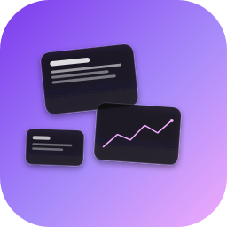
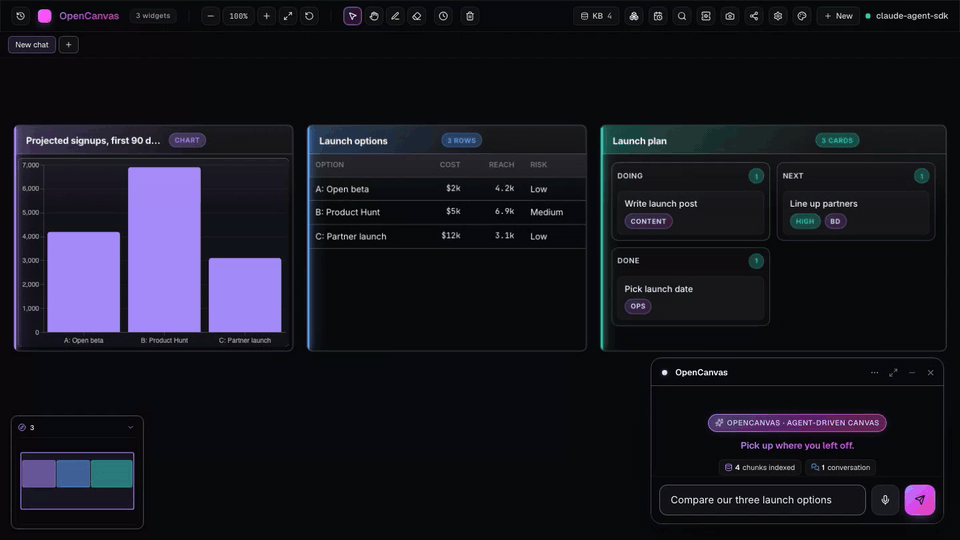
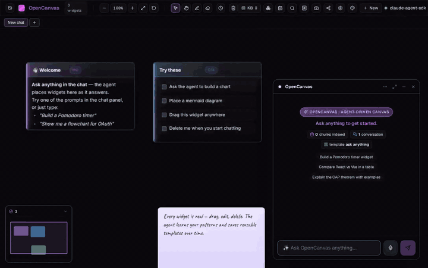
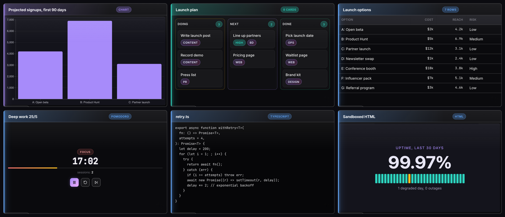

<div align="center">



# OpenCanvas

### Stop reading AI replies. Watch them assemble on an infinite canvas.

Ask a question and get a chart, a table and a kanban side by side, each one a real widget you can drag, pin and keep. Any model, including local, running on your machine under MIT.

[](https://github.com/ashark-ai-05/opencanvas/actions/workflows/ci.yml)
[](./docs/guide.md#develop)
[](./LICENSE)
[](https://github.com/ashark-ai-05/opencanvas/stargazers)



<p>
  <a href="https://opencanvas-production.up.railway.app"><b>▶︎ Try the live demo</b></a>
  &nbsp;·&nbsp;
  <a href="#start-in-60-seconds"><b>🚀 Run it locally</b></a>
  &nbsp;·&nbsp;
  <a href="https://github.com/ashark-ai-05/opencanvas/stargazers"><b>⭐ Star the repo</b></a>
</p>

</div>

---

## Why a canvas

Chat is a stream. The things you actually want from a model are not.

<p align="center">
  
</p>

The model never prints the answer. It calls `place_widget` with a typed payload, a schema checks it, tldraw draws it. Answers become objects you can drag, pin, link and export. The chat shrinks to one line. The canvas remembers everything across conversations.

---

## Start in 60 seconds

```bash
git clone https://github.com/ashark-ai-05/opencanvas.git && cd opencanvas
pnpm install && pnpm start      # builds once, opens http://127.0.0.1:3457
```

One process, one port, no `.env` needed. **Already have a model?** On first run OpenCanvas picks it up automatically: an `ANTHROPIC_API_KEY`, `OPENAI_API_KEY`, `GEMINI_API_KEY`, `GROQ_API_KEY` or `OPENROUTER_API_KEY` in your environment, or a running Ollama. Otherwise connect one later in **Settings** ([Pick a model](./docs/guide.md#pick-a-model)). Prefer the desktop app? `pnpm electron:dev`. Hacking on the UI with hot reload? `pnpm dev`.

**No API key? Start typing anyway.** Timers, checklists, reminders, events, notes, arithmetic and unit conversions are recognised as you type and placed on Enter, with no model call at all. This is an unedited recording of a fresh install:

<p align="center">
  
</p>

<sub>Recorded with <code>node scripts/record-first-run.mjs</code> against <code>pnpm start</code>. The captions are an overlay and the table is this repo's real <code>git log</code>. The hero GIF above is a scripted dashboard streamed in over the same REST API (<code>scripts/record-demo.mjs</code>), not a live model run.</sub>

---

## What you get

- **Any model, same agent.** Anthropic, OpenAI, Gemini, Groq, OpenRouter, or Ollama for fully offline. One tool-calling loop for all of them.
- **15 typed widget kinds**, from Vega-Lite charts and kanbans to live timers and sandboxed HTML. Adding one is a schema and a component; the model picks it up from the tool description.
- **The model grows its own toolbox.** It can register new widget kinds mid-conversation and reuse them later. A Python REPL and a JS REPL ship as examples.
- **MCP-native.** Point it at your filesystem, GitHub or Jira through any MCP server. Works with every provider, not just Claude.
- **Memory that compounds.** Every conversation indexes into a local SQLite + sqlite-vec store. `⌘K` finds any widget from any chat, weeks later.
- **Drive it from anywhere.** A REST API and SSE bus let cron jobs, scripts and other agents place widgets on your canvas.
- **Yours.** Binds to `127.0.0.1`, token-guarded routes, null-origin sandboxes for model-written HTML, no telemetry. [Threat model](./SECURITY.md).

<p align="center">
  
</p>

*Six of the 15 built-in widget kinds. Each is a schema plus a React component; the model learns them from the tool description.*

### OpenCanvas or mcp-screen?

Same visual language, different jobs:

| You want… | Use |
|---|---|
| A full chat-plus-canvas workspace with any model, memory, a KB and schedules | **OpenCanvas** (this repo) |
| A screen that your existing terminal agent (Claude Code, Codex, opencode) draws on, next to the terminal you already use | **[mcp-screen](https://github.com/ashark-ai-05/mcp-screen)** |

mcp-screen reuses OpenCanvas's event bus, widget-registry and null-origin sandbox designs, without tldraw or a chat UI of its own. Scripts and agents can also draw on OpenCanvas directly: `POST /v1/canvas/widgets` ([API reference](https://ashark-ai-05.github.io/opencanvas/api.html)).

---

## Go deeper

| I want to… | Read |
|---|---|
| Configure providers, MCP servers, plugins, the REST API | [docs/guide.md](./docs/guide.md) |
| Browse every endpoint | [API reference](https://ashark-ai-05.github.io/opencanvas/api.html) |
| Understand how the agent and canvas fit together | [docs/plans/unified-agent.md](./docs/plans/unified-agent.md) |
| See how instant widgets work without a model | [docs/plans/fast-lane-intent.md](./docs/plans/fast-lane-intent.md) |
| Host my own public demo in ten minutes | [docs/deploy-railway.md](./docs/deploy-railway.md) |
| Contribute a widget kind or fix a bug | [CONTRIBUTING.md](./CONTRIBUTING.md) |
| Report a vulnerability or read the security model | [SECURITY.md](./SECURITY.md) |
| See what changed | [CHANGELOG.md](./CHANGELOG.md) · [Discussions](https://github.com/ashark-ai-05/opencanvas/discussions) |

---

<div align="center">

If this is the direction you want AI tools to go, **[star the repo](https://github.com/ashark-ai-05/opencanvas/stargazers)**. It's how other people find it.

[MIT](./LICENSE) · built with tldraw, Hono, SQLite and the Vercel AI SDK

</div>
